# 🚀 AstroCare — Astronaut Health Monitoring System (AstroVital Intelligence Engine)

> **Every Heartbeat. Beyond Earth.**  
> Built by **Team AlgoX** for the **NASA Space Apps Challenge**.  
> *Research Prototype Platform — Not a certified medical diagnostic system.*

---

## 🛰️ 1. Project Overview & Problem Statement

Astronauts on long-duration exploration missions (e.g., Artemis deep-space transits and Mars expeditions) encounter prolonged microgravity, cosmic ionizing radiation, acoustic confinement, and isolated habitats. These space stressors induce cardiovascular deconditioning, cephalad fluid redistribution, circadian disruptions, and bone-muscle loss.

**AstroCare** is an end-to-end mission intelligence and astronaut physiological health dashboard designed to:
- **Monitor Vital Indicators:** Track Heart Rate (BPM), Blood Oxygen (SpO₂), Core Body Temperature (°C), Arterial Blood Pressure (mmHg), Sleep Duration (hrs), Physical Activity (METs), and Cosmic Radiation Exposure (μSv/h & cumulative mSv).
- **Distinguish Data Integrity:** Transparently classify every measurement as `[MEASURED]`, `[SIMULATED]`, or `[UNAVAILABLE]` to eliminate confusion.
- **Multivariate AI Anomaly Detection:** Run Scikit-learn **Isolation Forest** algorithms combined with transparent rule-based clinical boundary heuristics.
- **Explainable Anomaly Scoring:** Attribute anomalous deviations directly to contributing indicators (e.g. resting tachycardia vs hypoxia vs sensor displacement).
- **Plain-Language AI Health Insights:** Generate intuitive natural-language summaries from stored telemetry and suggest countermeasure protocols (ARED resistive exercise, fluid loading, sleep acoustic masking, radiation storm retreat).
- **Interactive Health Analytics:** Multi-temporal Recharts trend analysis (24h, 7d, 30d, all-mission) with anomaly flags.
- **Alert Triage Operations:** Classify alerts by severity (*Info*, *Review Required*, *Critical*) and origin (*Physiological Concern* vs *Sensor Quality Issue*), with review notes and status triage.
- **Crew Profiles & Baselines:** Manage individualized pre-flight authorized medical baselines for each crew member.
- **Mission Health Reports & Export:** Generate clinical summaries with 1-click **CSV export** and **Printable / PDF report** formatting.
- **Realistic Telemetry Simulator:** Synthesize circadian rhythms, microgravity daily workout sessions, and inject targeted anomaly scenarios.

---

## 🏛️ 2. System Architecture

```mermaid
graph TD
    subgraph Frontend ["React.js + Vite Frontend (AstroCare UI)"]
        UI_Dash["Astronaut Health Dashboard (/dashboard)"]
        UI_Trends["Health Trend Analytics (/dashboard/analytics)"]
        UI_AI["AI Anomaly Intelligence (/ai-insights)"]
        UI_Alerts["Alert Triage Center (/dashboard/alerts)"]
        UI_Profile["Astronaut Profile & Baseline (/dashboard/profile)"]
        UI_Reports["Mission Reports & PDF/CSV Export (/dashboard/reports)"]
        UI_Sim["Telemetry Simulator Studio (/dashboard/simulator)"]
        UI_Auth["Role Auth Gateway (/login)"]
    end

    subgraph Backend ["FastAPI Python Backend"]
        API_Gateway["FastAPI Gateway (/api)"]
        Router_Readings["Readings Router (/api/health-readings)"]
        Router_Trends["Trends Router (/api/health-trends)"]
        Router_Anom["Anomaly Router (/api/analyze)"]
        Router_Alerts["Alerts Router (/api/alerts)"]
        Router_Astro["Astronauts Router (/api/astronauts)"]
        Router_Reports["Reports Router (/api/reports)"]
        Router_Sim["Simulator Router (/api/simulator)"]
        Router_Auth["Auth Router (/api/auth)"]
    end

    subgraph AI_Engine ["AI & Analytics Module"]
        IForest["Scikit-Learn Isolation Forest"]
        Scaler["StandardScaler Normalization"]
        RuleEngine["Explainable Boundary Heuristics"]
        NL_Synthesizer["Clinical Natural Language Engine"]
    end

    subgraph Storage ["Persistent SQLite Database"]
        DB_Readings[("readings table")]
        DB_Astro[("astronauts table")]
        DB_Anom[("anomalies table")]
        DB_Alerts[("alerts table")]
        DB_Reports[("reports table")]
        DB_Users[("users table")]
    end

    UI_Dash --> API_Gateway
    UI_Trends --> API_Gateway
    UI_AI --> API_Gateway
    UI_Alerts --> API_Gateway
    UI_Profile --> API_Gateway
    UI_Reports --> API_Gateway
    UI_Sim --> API_Gateway
    UI_Auth --> API_Gateway

    API_Gateway --> Router_Readings
    API_Gateway --> Router_Trends
    API_Gateway --> Router_Anom
    API_Gateway --> Router_Alerts
    API_Gateway --> Router_Astro
    API_Gateway --> Router_Reports
    API_Gateway --> Router_Sim
    API_Gateway --> Router_Auth

    Router_Anom --> IForest
    Router_Anom --> Scaler
    Router_Anom --> RuleEngine
    Router_Trends --> NL_Synthesizer

    Router_Readings --> DB_Readings
    Router_Astro --> DB_Astro
    Router_Anom --> DB_Anom
    Router_Alerts --> DB_Alerts
    Router_Reports --> DB_Reports
    Router_Auth --> DB_Users
```



---

## 🛠️ 3. Technology Stack

| Layer | Technologies |
| :--- | :--- |
| **Frontend** | React 19, Vite, TypeScript, Recharts, Lucide React, Space Mission CSS Glassmorphism |
| **Backend** | Python 3.11+, FastAPI, Uvicorn, Pydantic V2 |
| **AI & ML** | Scikit-learn (Isolation Forest), NumPy, Pandas |
| **Database** | SQLite 3 (WAL mode, schema auto-migration) |
| **Security** | SHA-256 salted credentials, Bearer role authentication |
| **Testing** | Pytest, Pytest-Asyncio, HTTPX TestClient |

---

## 📡 4. REST API Documentation

### Application Health & Profile
- `GET /api/health` — Application health status, database state, and record counts.
- `GET /api/astronauts` — List available astronaut profiles (`ASTRO-01`, `ASTRO-02`, `ASTRO-03`).
- `GET /api/astronauts/{astronaut_id}` — Get single astronaut profile and authorized medical baseline.
- `PUT /api/astronauts/{astronaut_id}` — Update authorized baseline parameters.

### Telemetry & Analytics
- `GET /api/health-readings` — Retrieve paginated readings with metric and date filters (alias: `/api/readings`).
- `POST /api/health-readings` — Ingest and validate a new physiological reading.
- `GET /api/health-trends?range={24h|7d|30d|all}&astronaut_id={id}` — Retrieve chart-ready multi-point trend data with anomaly flags and plain-language trend insights.
- `GET /api/readings/timeseries?metric={metric}&limit={n}` — Raw time-series points.

### AI Anomaly Detection & Alerts
- `POST /api/analyze?contamination=0.05&limit=500` — Execute Isolation Forest multivariate analysis and generate explainable alerts.
- `GET /api/anomalies` — List flagged outlier observations with decision scores.
- `GET /api/alerts` — Query alerts filtered by severity (`critical`, `warning`, `info`), type (`health_concern`, `data_quality`), and status (`pending`, `reviewed`, `dismissed`, `escalated`).
- `PATCH /api/alerts/{alert_id}` — Update triage review status and doctor notes.
- `PATCH /api/alerts/{alert_id}/acknowledge` — Quick-acknowledge an alert.

### Reports & Simulator
- `POST /api/reports/generate` — Generate a clinical mission health evaluation for selected date range.
- `GET /api/reports` — List archived mission health reports.
- `GET /api/reports/{report_id}` — Fetch detailed report JSON.
- `GET /api/reports/{report_id}/export/csv` — Download structured CSV medical report.
- `GET /api/simulator/status` — Get simulator engine status.
- `POST /api/simulator/step` — Generate the next chronological 30-min telemetry record with chosen scenario.
- `POST /api/simulator/reset` — Reset database to clean 500-record baseline.

### Authentication
- `POST /api/auth/login` — Prototype authentication for Astronaut or Flight Surgeon.
- `GET /api/auth/me` — Get current authenticated user profile.

---

## 💻 5. Installation & Step-by-Step Setup

### Prerequisites
- **Node.js** (v18+) & **npm**
- **Python** (3.11+)

### Backend Setup
```bash
# 1. Navigate to backend directory
cd backend

# 2. (Optional) Create and activate virtual environment
python -m venv venv
# On Windows:
venv\Scripts\activate
# On Linux/macOS:
source venv/bin/activate

# 3. Install Python dependencies
pip install -r requirements.txt

# 4. Start the FastAPI server (runs on http://localhost:8000)
python main.py
```

### Frontend Setup
```bash
# 1. Open a new terminal and navigate to frontend directory
cd frontend

# 2. Install dependencies
npm install

# 3. Start the Vite development server (runs on http://localhost:5173)
npm run dev
```

### Running Backend Automated Tests
```bash
cd backend
python -m pytest
```

---

## 🎬 6. Demo Scenario for NASA Space Apps Presentation

Follow this 3-minute demonstration script for judging:

1. **Mission Welcome & Overview (`/`)**:
   - Introduce **AstroCare** by **Team AlgoX**: A space mission intelligence platform designed for long-duration crew health monitoring.
2. **Launch Mission Console (`/dashboard`)**:
   - Note the header: Active crew member **CDR Alex Vance (ASTRO-01)**, Mission **ARTEMIS-VII**, Sol **142 of 180**.
   - Observe the Environmental Telemetry strip: Cabin O₂ (21.2%), Pressure (101.3 kPa).
   - Point out the **7 Core Physiological Indicator Cards**: Heart Rate, SpO₂, Core Temp, Blood Pressure, Sleep Duration, Physical Activity, Radiation Dose Rate. Highlight the explicit `[SIMULATED]`, `[MEASURED]`, and `[UNAVAILABLE]` badges.
3. **Health Trend Analytics (`/dashboard/analytics`)**:
   - Switch between **24 Hours**, **7 Days**, and **30 Days**.
   - Notice the dashed Cyan baseline comparison line and glowing Coral anomaly point overlays on the Recharts graph.
   - Point out the automated **Statistical Distribution** (Mean, Std Dev, Min/Max) and the data-based trend explanations.
4. **AI Anomaly Detection Studio (`/ai-insights`)**:
   - Adjust the **Contamination Sensitivity** slider and click **"RUN ISOLATION FOREST"**.
   - Review the **Natural Language Insights** cards: *"Heart rate readings have varied within nominal limits during this monitoring window"*, and countermeasure directives for cardiovascular and sleep hygiene.
   - Inspect the **Anomaly Score Distribution** scatter plot and feature attribution table.
5. **Live Simulation & Anomaly Injection (`/dashboard/simulator`)**:
   - Click **"+ Inject Tachycardia"** or **"+ Inject SpO₂ Dip"**.
   - Watch the simulator synthesize the event, append it to the database, and trigger an active alert.
6. **Alert Center Triage (`/dashboard/alerts`)**:
   - View the newly generated alert. Note the clear distinction between **Physiological Concerns** vs **Sensor Quality Issues**.
   - Click **"Clinical Review"**, update the status to **"Reviewed & Nominal"**, add flight surgeon notes, and save.
7. **Mission Health Report Generation & Export (`/dashboard/reports`)**:
   - Select CDR Alex Vance and click **"Generate New Report"**.
   - Preview the NASA-style mission medical assessment.
   - Click **"Export CSV"** to instantly download the raw data, or **"Print / PDF Export"** to view the formatted printable summary.

---

## ⚖️ 7. Ethical AI & Medical Disclaimer

> **Research Prototype Disclaimer:**  
> AstroCare is an engineering demonstration and research prototype developed for the NASA Space Apps Challenge.  
> - It is **not** certified by the FDA, NASA, ESA, or any medical regulatory agency for human clinical diagnostics.  
> - All telemetry values are simulated or synthetic demonstrations and are explicitly labeled as `[SIMULATED]`.  
> - Unsupervised machine learning models (Isolation Forest) detect statistical outliers and must never substitute for licensed flight medical officer judgement.

---

**Team AlgoX • NASA Space Apps Challenge**
